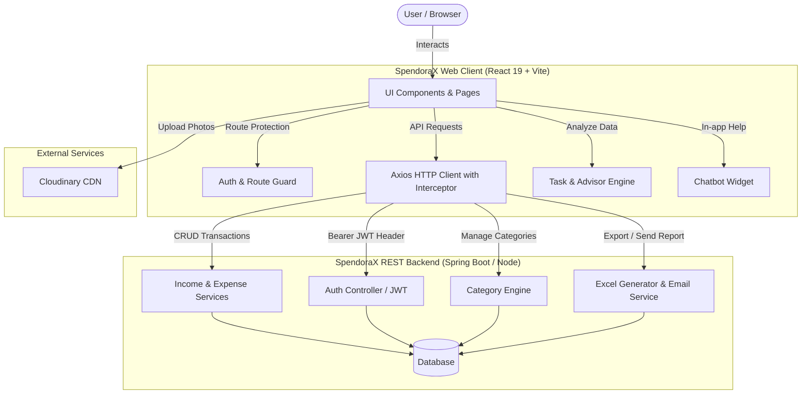
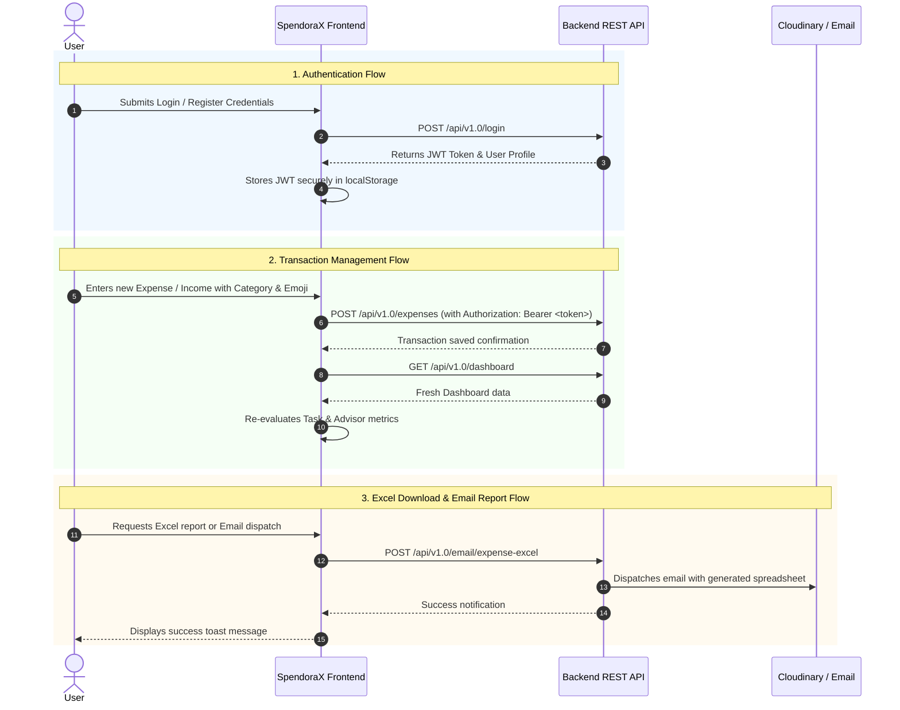

# 💳 SpendoraX — Smart Financial Management & AI Advisor Web Application

SpendoraX is a modern, responsive personal finance and money management web application designed to help users track expenses, manage multiple income streams, analyze financial health with interactive visualizations, and receive intelligent financial advisory tips and automated budget tasks.

---

## 🌟 Key Features

- **📊 Comprehensive Financial Dashboard**
  - Real-time calculations of Total Income, Total Expenses, and Net Balance.
  - Interactive trend visualizations and comparative charts powered by Recharts.
  - Recent transactions breakdown with category icons and emojis.

- **💸 Income & Expense Management**
  - Seamless entry, editing, and deletion of income and expense items.
  - Rich categorization with custom emoji icons (`emoji-picker-react`).
  - Historical ledger with pagination and chronological sorting.

- **🤖 Smart Tasks & Financial Advisor Engine**
  - Rule-based AI advisory engine (`taskAdvisorEngine.js`) calculating financial health scores.
  - Automatic budget warnings, emergency fund tracking, and spending habit diagnostics.
  - Interactive **Chatbot Widget** for conversational financial assistance.

- **📑 Excel Export & Email Reports**
  - One-click export of transactions to Excel spreadsheets.
  - Direct email delivery feature allowing users to send financial summaries straight to their inbox.

- **🔍 Advanced Multi-Criteria Filtering**
  - Dynamic filtering by date ranges, transaction types, categories, and amount thresholds.
  - Instant search across all transaction records.

- **🔒 Secure Authentication & User Profiles**
  - JWT (JSON Web Token) based authentication with secure authorization interceptors.
  - User profile management with Cloudinary image upload integration.

---

## 🏗️ System Architecture & Workflow

### 1. High-Level Architecture



### 2. Core User Workflows



---

## 📂 Project Directory Structure

```text
SpendoraXwebapp/
├── public/                  # Static assets
├── src/
│   ├── assets/              # Logos, brand images, and SVG illustrations
│   ├── components/          # Reusable UI & Business components
│   │   ├── AddCategoryForm.jsx
│   │   ├── AddExpenseForm.jsx
│   │   ├── AddIncomeForm.jsx
│   │   ├── CategoryList.jsx
│   │   ├── ChatbotWidget.jsx
│   │   ├── CustomLineChart.jsx
│   │   ├── Dashboard.jsx
│   │   ├── EmailReportModal.jsx
│   │   ├── EmojiPickerPopup.jsx
│   │   ├── ExpenseList.jsx
│   │   ├── IncomeList.jsx
│   │   ├── Menubar.jsx
│   │   ├── ProfilePhotoSelextor.jsx
│   │   └── Sidebar.jsx
│   ├── context/             # React context providers (User / Auth context)
│   ├── hooks/               # Custom React hooks
│   ├── pages/               # Top-level route pages
│   │   ├── Home.jsx         # Main analytical dashboard
│   │   ├── Income.jsx       # Income tracking view
│   │   ├── Expense.jsx      # Expense tracking view
│   │   ├── Category.jsx     # Category customization view
│   │   ├── Filter.jsx       # Advanced transaction filtering & search
│   │   ├── TasksAndAdvisor.jsx # Smart Financial Advisor & Goals
│   │   ├── Login.jsx        # User login
│   │   └── Signup.jsx       # User registration
│   ├── util/                # Utilities, API configurations, and engines
│   │   ├── apiEndpoints.js  # Centralized REST API endpoint mappings
│   │   ├── axiosConfig.jsx  # Axios instance with JWT interceptors
│   │   ├── helper.js        # Formatting, currency, and date helpers
│   │   ├── taskAdvisorEngine.js # AI / Rule-based financial evaluation engine
│   │   └── uploadProfileImage.js # Cloudinary upload helper
│   ├── App.jsx              # Main routing definition
│   ├── index.css            # Tailwind CSS styling and global styles
│   └── main.jsx             # React DOM root entry point
├── .env.example             # Template for environment configuration
├── .gitignore               # Strict gitignore ensuring security & ignoring keys
├── eslint.config.js         # ESLint configuration
├── index.html               # Main HTML entry
├── package.json             # NPM dependencies and scripts
└── vite.config.js           # Vite build and plugin configuration
```

---

## 🛠️ Technology Stack

| Layer | Technologies |
|---|---|
| **Framework & Build** | [React 19](https://react.dev/), [Vite 8](https://vitejs.dev/) |
| **Styling & Icons** | [Tailwind CSS v4](https://tailwindcss.com/), [Material Tailwind](https://www.material-tailwind.com/), [Lucide React](https://lucide.dev/) |
| **Data Visualization** | [Recharts 3](https://recharts.org/) |
| **HTTP & Networking** | [Axios](https://axios-http.com/) |
| **UI Enhancements** | [React Hot Toast](https://react-hot-toast.com/), [Emoji Picker React](https://www.npmjs.com/package/emoji-picker-react), [Moment.js](https://momentjs.com/) |
| **Routing** | [React Router DOM v7](https://reactrouter.com/) |
| **Media Hosting** | [Cloudinary API](https://cloudinary.com/) |

---

## 🔒 Security Best Practices: Ignoring Private Keys & Secrets

> [!IMPORTANT]
> **Never commit private keys, `.env` files, certificates, or API secrets into Git.** Once pushed to a remote repository (especially a public or shared one), exposed credentials must be treated as permanently compromised.

### What is Protected in `.gitignore`:
- **Environment variables**: `.env`, `.env.*`, `*.env` (only `.env.example` is committed).
- **Cryptographic keys & certs**: `*.pem`, `*.key`, `*.pkcs12`, `*.pfx`, `*.p12`, `*.cer`, `*.crt`, `id_rsa*`.
- **Cloud & Service Accounts**: `credentials.json`, `service-account*.json`, `client_secret*.json`, `jwt_secret*`.
- **System & Build artifacts**: `node_modules/`, `dist/`, logs, and temporary OS files.

---

## 🚀 Getting Started

### 1. Prerequisites
- [Node.js](https://nodejs.org/) (version 18.x or higher)
- [npm](https://www.npmjs.com/) or [yarn](https://yarnpkg.com/)
- [Git](https://git-scm.com/)

### 2. Installation
Clone the repository and install all dependencies:
```bash
git clone <your-repository-url>
cd SpendoraX/SpendoraXwebapp
npm install
```

### 3. Environment Configuration
Create a `.env` file from the provided `.env.example` template:
```bash
cp .env.example .env
```
Update `.env` with your actual backend URL and Cloudinary details:
```env
VITE_API_BASE_URL=https://money-manager-backend-9jk6.onrender.com/api/v1.0
VITE_CLOUDINARY_CLOUD_NAME=drjxkgaro
VITE_CLOUDINARY_UPLOAD_PRESET=your_preset
```

### 4. Running the Development Server
```bash
npm run dev
```
The application will start locally at `http://localhost:5173/`.

---

## 📦 Available Scripts

| Command | Description |
|---|---|
| `npm run dev` | Starts the Vite development server with Hot Module Replacement (HMR). |
| `npm run build` | Compiles and bundles production-ready static assets into `dist/`. |
| `npm run preview`| Locally previews the production build. |
| `npm run lint` | Runs ESLint to check for code quality and style issues. |

---

## 🤝 Contributing & License
Contributions, issues, and feature requests are welcome!
Feel free to open an issue or submit a pull request.
